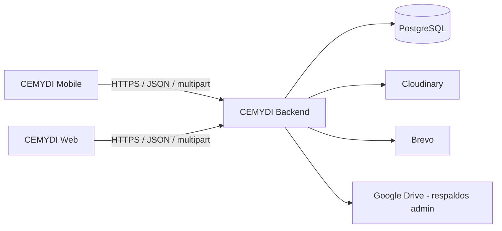
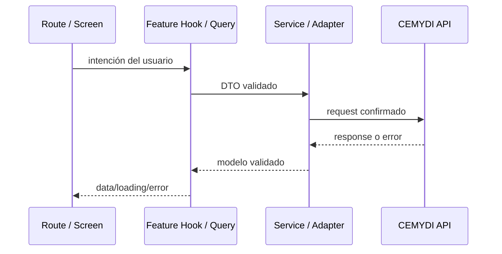

# Arquitectura de CEMYDI Mobile

## CURRENT STRUCTURE

La aplicación conserva un scaffold pequeño y ya incluye foundation transversal. La estructura relevante es:

```text
cemydi-mobile/
├── src/
│   ├── app/
│   ├── components/ui/
│   ├── config/
│   ├── providers/
│   ├── services/http/
│   └── theme/
├── assets/
│   ├── branding/              # Variantes del logotipo y emblema
│   ├── icons/                 # Iconos activos de la aplicación
│   ├── images/onboarding/     # Imágenes de la bienvenida
│   └── legacy/expo-template/  # Recursos anteriores sin referencias activas
├── .agents/skills/
├── app.json
├── babel.config.js
├── global.css
├── metro.config.js
├── tailwind.config.js
└── tsconfig.json
```

Existen features de bienvenida, Home, catálogo público y detalle conectado, carrito y autenticación de muestra, con pruebas Jest/Testing Library. La foundation incluye transporte HTTP sin autenticación, TanStack Query y componentes base. Las lecturas públicas de productos/promociones están integradas; no existe transporte de sesión móvil aprobado. Véase [CATALOG.md](./CATALOG.md).

La ruta inicial presenta tres pantallas de bienvenida con imágenes locales y conduce al catálogo público `/inicio` con acceso opcional a `/login`; perfil y revisión del carrito solicitan sesión local y conservan el destino de retorno. `features/auth` contiene formularios, schemas y un servicio temporal aislado mediante `AuthPreviewProvider`, sin transporte de sesión ni integración con la API. Registro verifica correo con OTP antes del login; recuperación verifica OTP antes de cambiar contraseña. Ver `AUTH_PREVIEW.md`.

Inicio compone `features/home/HomeScreen`: banner y cuatro categorías editoriales originales con imágenes locales, disponibles desde el primer render, y seis productos reales. Sus acciones llevan a `/catalogo`; búsqueda y filtros consultan la API completa. `src/services/products` contiene contratos Zod, servicio HTTP y adapters compartidos por Home, catálogo y detalle. Los productos de muestra de `src/data/catalog-preview.ts` quedan para recorridos locales; sus tipos son modelos de presentación. El detalle consulta también reseñas y recomendaciones públicas. Por elección del usuario, el carrito temporal acepta snapshots de presentación de productos reales durante la sesión; muestra importes estimados y no consume el carrito autenticado del backend. La ruta histórica `/diagnostico` ya no existe.

## Arquitectura global confirmada



El backend es la única fuente de verdad para seguridad, autorización, persistencia y reglas de negocio. Google Drive no es una dependencia directa del móvil.

## TARGET STRUCTURE

La siguiente estructura es un objetivo incremental. No describe carpetas existentes y no obliga a crearlas antes de que tengan un consumidor real.

```text
src/
├── app/                      # Solo rutas y layouts de Expo Router
├── features/
│   ├── auth/
│   ├── home/
│   ├── catalog/
│   ├── products/
│   ├── cart/
│   ├── rentals/
│   └── profile/
├── components/               # UI compartida entre features
├── services/                 # Cliente HTTP e infraestructura transversal
├── providers/                # Providers de alcance de aplicación
├── hooks/                    # Hooks transversales, no específicos de feature
├── lib/                      # Utilidades e integración de librerías
├── types/                    # Tipos realmente compartidos
├── utils/                    # Funciones puras transversales
└── theme/                    # Tokens semánticos y primitives visuales
```

Una feature puede contener solo lo que necesite:

```text
features/catalog/
├── components/
├── hooks/
├── services/
├── schemas/
├── types/
└── adapters/
```

No crees todos estos subdirectorios por plantilla. Empieza cerca del consumidor y promueve código a compartido cuando haya reutilización real.

## Capas objetivo

### Presentación

- archivos de ruta bajo `src/app`;
- pantallas y componentes;
- formularios y navegación;
- estados visuales, accesibilidad y responsive.

No realiza fetch directo ni contiene reglas de precios, permisos o transición de estados.

### Estado y datos

- TanStack Query para estado remoto;
- React Hook Form y Zod para formularios;
- providers pequeños para infraestructura o estado transversal real;
- estado local para interacción efímera.

La caché no reemplaza al backend. Las mutaciones deben invalidar o actualizar las query keys afectadas.

### Servicios

- configuración de URL por entorno;
- cliente HTTP compartido;
- autenticación cuando su estrategia sea aprobada;
- serialización JSON y multipart;
- schemas de respuesta, DTOs y adapters.

Los services devuelven datos de dominio utilizables por la UI y errores normalizados; no renderizan ni navegan.

### Backend

- autenticación y autorización;
- validación normativa;
- reglas de catálogo, carrito, cupones y rentas;
- persistencia e integraciones externas.

## Flujo de una operación



Flujo resumido:

```text
screen → hook/query → service → API
```

## Patrones aplicables

- **Service Layer:** concentra transporte y contratos por dominio.
- **Adapter:** transforma respuestas externas cuando su forma no coincide con la UI o el modelo móvil.
- **Provider:** monta QueryClient, sesión u otra infraestructura transversal; no debe convertirse en un contenedor universal.
- **Observer:** TanStack Query notifica a consumidores cuando cambia el estado remoto.
- **Facade:** custom hooks exponen a las pantallas una API pequeña de queries y mutations.

Estos patrones se aplican donde reducen acoplamiento observable. No se crean interfaces, repositorios ni capas vacías por anticipación.

## Reglas de dependencia

1. `src/app` puede importar features, componentes y providers; el resto no debe depender de rutas.
2. La UI consume hooks o services de su feature, no el cliente HTTP de bajo nivel.
3. Features no importan internals de otras features. Mueve un contrato verdaderamente compartido a una ubicación transversal.
4. Services y adapters no importan componentes ni APIs de navegación.
5. Schemas validan límites externos; tipos TypeScript no validan runtime.
6. Ninguna capa móvil duplica autorización o reglas de negocio del backend.
7. Los secretos nunca se colocan en `EXPO_PUBLIC_*` ni en el bundle.

## Estado remoto y local

- Catálogo, perfil, carrito y rentas son estado remoto.
- Campos de formulario, tabs, modales y selección temporal son estado local.
- La sesión depende de la estrategia de autenticación todavía pendiente.
- Evita copiar el patrón `CartContext` web automáticamente: en móvil TanStack Query puede mantener el carrito remoto y sus invalidaciones.

## Decisiones arquitectónicas pendientes

- cookies frente a tokens explícitos para sesión móvil;
- persistencia segura y refresh;
- política offline más allá de detección de conectividad y refetch al recuperar foco o red;
- política offline;
- navegación autenticada final;
- soporte de tablet y breakpoints;
- ejecución nativa de E2E con Maestro y builds de prueba.

## Decisiones de UX y rendimiento vigentes

- El Stack raíz desactiva las transiciones nativas en Android (`animation: 'none'`) como mitigación del contenido desvanecido o blanco al navegar; iOS conserva su transición predeterminada. El contenedor y las escenas usan `colors.background`. No añadir fades por ruta en Android sin validar en dispositivo físico. La causa exacta del fallo reportado sigue pendiente de reproducción nativa.
- No se requiere un AppHeader global. Cada pantalla conserva su encabezado; piezas como BackButton se comparten cuando tienen una responsabilidad común.
- CatalogImage, ProductCard, AppBottomBar y AppSheet viven en UI compartida. Se eliminaron los cinco reexports de Home sin adaptación (incluido home-mocks); los imports apuntan a la implementación o fuente real.
- GlobalBottomBar se monta en el layout y aparece en Inicio, Catálogo y Carrito. Explorar abre `/catalogo`; el detalle conserva sus acciones propias.
- CatalogPreviewProvider conserva estado de sesión y acciones estables. Las tarjetas memoizadas consumen el contexto de acciones, por lo que cambiar otra selección/cantidad no fuerza su actualización. El contexto completo sigue notificando cambios legítimos a pantallas y resúmenes.
- AuthPreviewProvider memoiza su value. ToastProvider ya crea una única instancia de store con useState; QueryProvider ya crea un único QueryClient. No se añaden providers globales de conectividad/errores sin consumidores.
- Home conserva la key requerida por FlatList al cambiar numColumns y restaura el offset cuando se mide el contenido nuevo; el nativo puede limitarlo al final si el contenido queda más corto. No se promete conservar el mismo producto arriba cuando cambia el número de columnas.
- useHome usa ['home', 'products'], API pública, caché de 30 segundos y políticas compartidas de conectividad/foco/retry. Catálogo usa useInfiniteQuery con filtros normalizados; promociones y detalle tienen consultas separadas. Los fixtures no son fallback de producción.
- Home conserva cabecera/buscador durante la carga y revela sus secciones al recibir datos. ProductGridSkeleton representa tarjetas pendientes; CatalogImage representa la carga posterior de fotos. Las imágenes locales conservan hashes precalculados; el backend aún no entrega hashes remotos.
- Home y catálogo montan cabecera y buscador dentro de ListHeaderComponent, sin stickyHeaderIndices: se desplazan con la lista. Solo el desplegable usa AppScreenPopover, anclado al input y alojado por AppScreen fuera del scroll principal. Al arrastrar la lista se cierra; su propio arrastre/inercia mantienen aislados los gestos. No usa Modal ni AppSheet y limita su altura al espacio disponible sobre el teclado.
- OTP mantiene el reloj absoluto y su comprobación en el servicio; solo OtpResendButton se actualiza cada segundo, limpia listeners/intervalo y deja de contar al finalizar. La pausa breve tras verificar conserva la confirmación animada existente, no simula latencia de red.

Las convenciones para nuevas pantallas, imágenes y estados de carga están en [DESIGN_SYSTEM.md](./DESIGN_SYSTEM.md) y [CONVENTIONS.md](./CONVENTIONS.md).
