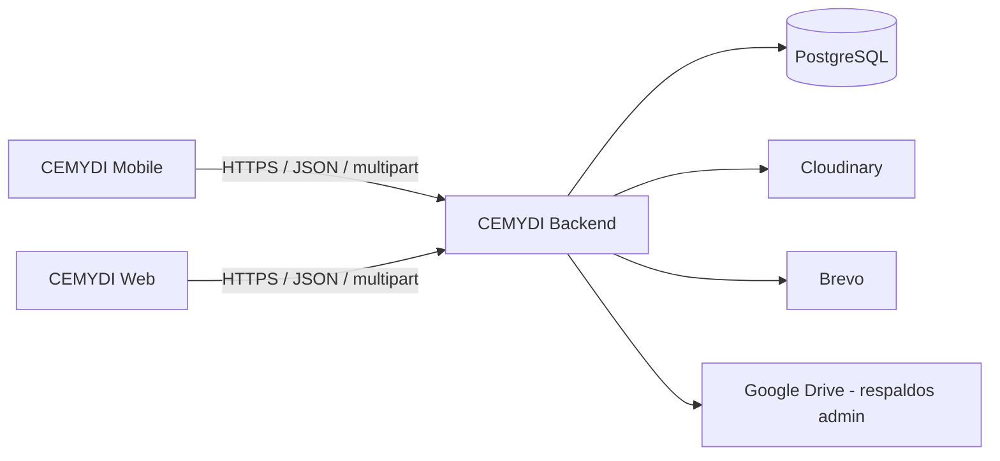
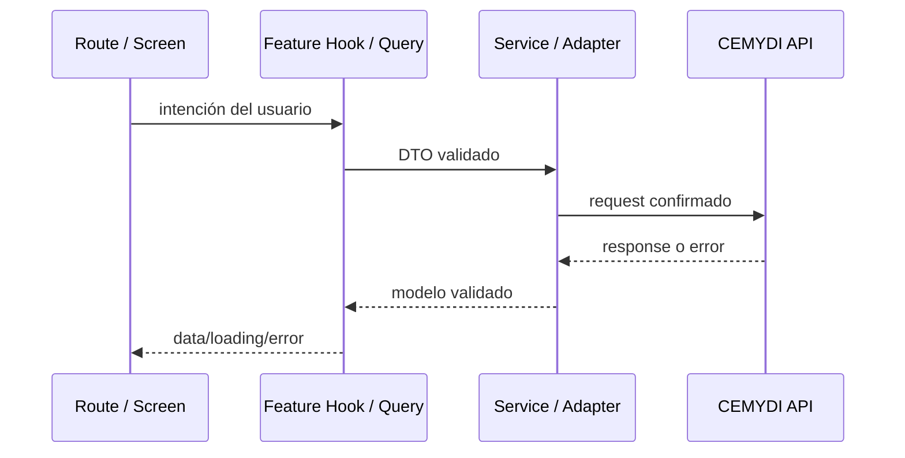

# Arquitectura de CEMYDI Mobile

## CURRENT STRUCTURE

La aplicación conserva un scaffold pequeño y ya incluye foundation transversal. La estructura relevante es:

```text
cemydi-mobile/
├── src/
│   ├── app/
│   ├── components/ui/
│   ├── config/
│   ├── providers/
│   ├── services/http/
│   └── theme/
├── assets/
│   ├── branding/              # Variantes del logotipo y emblema
│   ├── icons/                 # Iconos activos de la aplicación
│   ├── images/onboarding/     # Imágenes de la bienvenida
│   └── legacy/expo-template/  # Recursos anteriores sin referencias activas
├── .agents/skills/
├── app.json
├── babel.config.js
├── global.css
├── metro.config.js
├── tailwind.config.js
└── tsconfig.json
```

No existen todavía features funcionales, contratos de dominio ni tests. La foundation incluye transporte HTTP sin autenticación, configuración de TanStack Query y componentes base; que otras dependencias estén instaladas no significa que ya tengan una implementación.

La ruta inicial presenta tres pantallas de bienvenida con imágenes locales y conduce a `/inicio`. Inicio compone `features/home/HomeScreen`: banner rotativo, categorías horizontales y catálogo con búsqueda y filtros locales. Los datos e imágenes son mocks explícitos, sin integración de negocio. Los componentes y el hook de reproducción viven dentro de `features/home`; `home-mocks.ts` no representa un contrato del backend. La verificación manual de conectividad que consume `GET /` se conserva en `/diagnostico`.

## Arquitectura global confirmada



El backend es la única fuente de verdad para seguridad, autorización, persistencia y reglas de negocio. Google Drive no es una dependencia directa del móvil.

## TARGET STRUCTURE

La siguiente estructura es un objetivo incremental. No describe carpetas existentes y no obliga a crearlas antes de que tengan un consumidor real.

```text
src/
├── app/                      # Solo rutas y layouts de Expo Router
├── features/
│   ├── auth/
│   ├── home/
│   ├── catalog/
│   ├── products/
│   ├── cart/
│   ├── rentals/
│   └── profile/
├── components/               # UI compartida entre features
├── services/                 # Cliente HTTP e infraestructura transversal
├── providers/                # Providers de alcance de aplicación
├── hooks/                    # Hooks transversales, no específicos de feature
├── lib/                      # Utilidades e integración de librerías
├── types/                    # Tipos realmente compartidos
├── utils/                    # Funciones puras transversales
└── theme/                    # Tokens semánticos y primitives visuales
```

Una feature puede contener solo lo que necesite:

```text
features/catalog/
├── components/
├── hooks/
├── services/
├── schemas/
├── types/
└── adapters/
```

No crees todos estos subdirectorios por plantilla. Empieza cerca del consumidor y promueve código a compartido cuando haya reutilización real.

## Capas objetivo

### Presentación

- archivos de ruta bajo `src/app`;
- pantallas y componentes;
- formularios y navegación;
- estados visuales, accesibilidad y responsive.

No realiza fetch directo ni contiene reglas de precios, permisos o transición de estados.

### Estado y datos

- TanStack Query para estado remoto;
- React Hook Form y Zod para formularios;
- providers pequeños para infraestructura o estado transversal real;
- estado local para interacción efímera.

La caché no reemplaza al backend. Las mutaciones deben invalidar o actualizar las query keys afectadas.

### Servicios

- configuración de URL por entorno;
- cliente HTTP compartido;
- autenticación cuando su estrategia sea aprobada;
- serialización JSON y multipart;
- schemas de respuesta, DTOs y adapters.

Los services devuelven datos de dominio utilizables por la UI y errores normalizados; no renderizan ni navegan.

### Backend

- autenticación y autorización;
- validación normativa;
- reglas de catálogo, carrito, cupones y rentas;
- persistencia e integraciones externas.

## Flujo de una operación



Flujo resumido:

```text
screen → hook/query → service → API
```

## Patrones aplicables

- **Service Layer:** concentra transporte y contratos por dominio.
- **Adapter:** transforma respuestas externas cuando su forma no coincide con la UI o el modelo móvil.
- **Provider:** monta QueryClient, sesión u otra infraestructura transversal; no debe convertirse en un contenedor universal.
- **Observer:** TanStack Query notifica a consumidores cuando cambia el estado remoto.
- **Facade:** custom hooks exponen a las pantallas una API pequeña de queries y mutations.

Estos patrones se aplican donde reducen acoplamiento observable. No se crean interfaces, repositorios ni capas vacías por anticipación.

## Reglas de dependencia

1. `src/app` puede importar features, componentes y providers; el resto no debe depender de rutas.
2. La UI consume hooks o services de su feature, no el cliente HTTP de bajo nivel.
3. Features no importan internals de otras features. Mueve un contrato verdaderamente compartido a una ubicación transversal.
4. Services y adapters no importan componentes ni APIs de navegación.
5. Schemas validan límites externos; tipos TypeScript no validan runtime.
6. Ninguna capa móvil duplica autorización o reglas de negocio del backend.
7. Los secretos nunca se colocan en `EXPO_PUBLIC_*` ni en el bundle.

## Estado remoto y local

- Catálogo, perfil, carrito y rentas son estado remoto.
- Campos de formulario, tabs, modales y selección temporal son estado local.
- La sesión depende de la estrategia de autenticación todavía pendiente.
- Evita copiar el patrón `CartContext` web automáticamente: en móvil TanStack Query puede mantener el carrito remoto y sus invalidaciones.

## Decisiones arquitectónicas pendientes

- cookies frente a tokens explícitos para sesión móvil;
- persistencia segura y refresh;
- política offline más allá de detección de conectividad y refetch al recuperar foco o red;
- política offline;
- navegación autenticada final;
- soporte de tablet y breakpoints;
- framework de tests y E2E.
