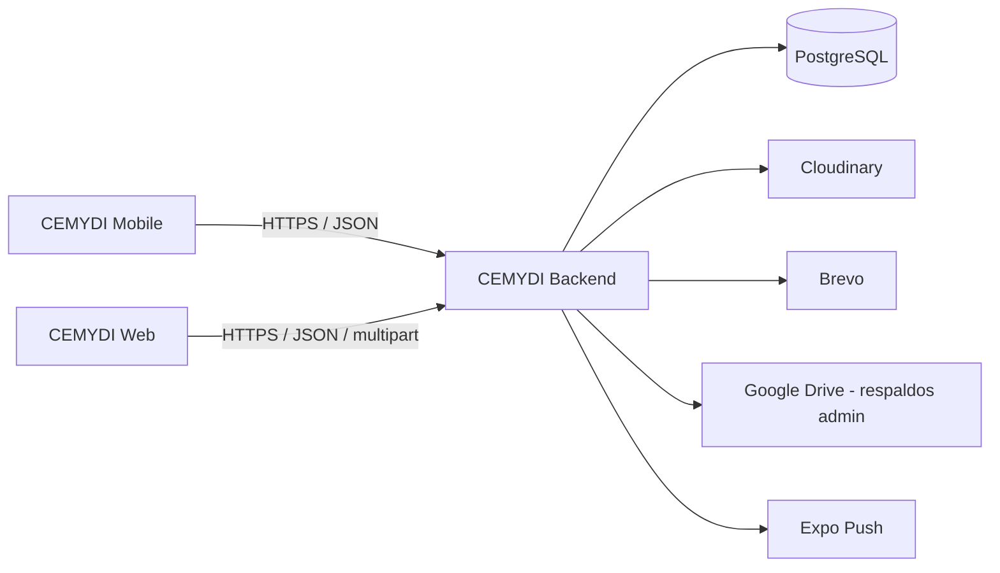
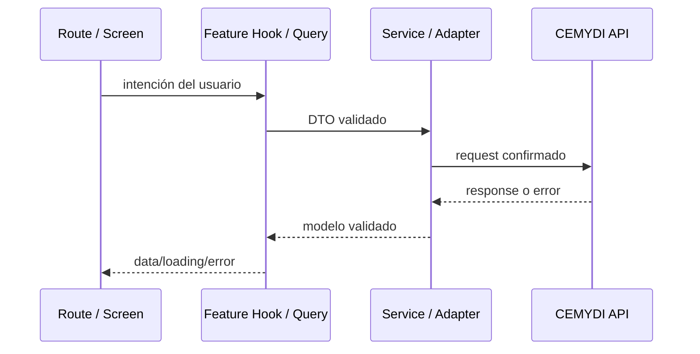

# Arquitectura de CEMYDI Mobile

## Estructura actual

```text
cemydi-mobile/
├── src/
│   ├── app/                    # Solo rutas y layouts de Expo Router
│   ├── components/             # UI compartida y ErrorBoundary
│   ├── config/                 # Validación de variables de entorno
│   ├── data/                   # Fixtures y datos de presentación locales
│   ├── features/
│   │   ├── auth/
│   │   ├── cart/
│   │   ├── catalog/
│   │   ├── favorites/
│   │   ├── home/
│   │   ├── notifications/
│   │   ├── onboarding/
│   │   ├── products/
│   │   └── profile/
│   ├── hooks/                  # Hooks transversales
│   ├── providers/              # Query, Auth, Cart, CatalogPreview y Toast
│   ├── services/
│   │   ├── http/               # Cliente, errores y tipos de transporte
│   │   └── products/           # Schemas, servicio, adapters y caché de catálogo
│   └── theme/                  # Tokens semánticos
├── assets/
│   ├── branding/
│   ├── icons/
│   ├── images/
│   └── legacy/expo-template/
├── plugins/                    # Config plugins de CNG
├── tests/                      # Integración y soporte compartido
├── app.json
├── app.config.js
├── babel.config.js
├── global.css
├── metro.config.js
├── tailwind.config.js
└── tsconfig.json
```

El cliente integra bienvenida, catálogo público, autenticación con tokens explícitos,
perfil, favoritos, carrito conectado y bandeja/preferencias de notificaciones.
Los contratos y límites vigentes están en [AUTHENTICATION.md](./AUTHENTICATION.md),
[CATALOG.md](./CATALOG.md), [CART.md](./CART.md) y [NOTIFICATIONS.md](./NOTIFICATIONS.md).

El Stack raíz monta proveedores compartidos y `NotificationLifecycle`. El grupo
`src/app/(tabs)` contiene Inicio, Catálogo, Carrito y Perfil, manteniendo sus URLs.
La barra existente vive como tabBar del navegador; los detalles y formularios se
apilan fuera del grupo. Perfil evalúa las redirecciones privadas solo con foco.
Catálogo conserva su estado al cambiar de pestaña y aplica nuevos parámetros de
Inicio sin remontarse. Véase [MOBILE_QUALITY.md](./MOBILE_QUALITY.md).

Home conserva banner/categorías editoriales y consulta seis productos reales.
Catálogo acumula páginas remotas de 24. Los fixtures siguen aislados para pruebas;
no son fallback de la API. CatalogPreviewProvider mantiene únicamente favoritos
locales de muestra y carrito temporal de invitado. CartProvider usa TanStack Query
para el carrito autenticado y sus mutaciones. No hay pago ni contratación nueva.

No se versionan `ios/` ni `android/`. `app.config.js` extiende `app.json` con Google Sign-In, `google-services.json` y el project ID de EAS.

## Arquitectura global



El backend es la única fuente de verdad para seguridad, autorización, persistencia y reglas de negocio. Google Drive no es una dependencia directa del móvil.

## Capas

### Presentación

- archivos de ruta delgados bajo `src/app`;
- pantallas y componentes dentro de cada feature;
- formularios, navegación, accesibilidad y estados visuales.

No realiza fetch directo ni contiene reglas de precios, permisos o transición de estados.

### Estado y datos

- TanStack Query para estado remoto;
- React Hook Form y Zod para formularios;
- providers pequeños para infraestructura o estado transversal real;
- estado local para interacción efímera.

La caché no reemplaza al backend. Las mutaciones invalidan o actualizan las query keys afectadas.

### Servicios

- configuración validada de URL por entorno;
- cliente HTTP compartido;
- autenticación Bearer para recursos privados;
- serialización JSON;
- schemas de respuesta, DTOs y adapters.

Los services devuelven datos de dominio utilizables por la UI y errores normalizados; no renderizan ni navegan.

### Backend

- autenticación y autorización;
- validación normativa;
- reglas de catálogo, carrito, cupones, rentas y notificaciones;
- persistencia e integraciones externas.

## Flujo de una operación



Flujo resumido:

```text
screen → hook/query → service → API
```

## Providers

El layout raíz monta, de exterior a interior:

1. `ErrorBoundary`
2. `QueryProvider`
3. `CatalogPreviewProvider`
4. `SafeAreaProvider`
5. `ToastProvider`
6. `AuthProvider`
7. `CartProvider`

Responsabilidades:

- `QueryProvider`: QueryClient único, políticas de retry, foco, reconexión y pausa offline mediante Expo Network.
- `CatalogPreviewProvider`: estado local de invitado para favoritos y carrito de muestra durante el proceso.
- `ToastProvider`: una sola instancia de store y viewport.
- `AuthProvider`: sesión, restauración, refresh, logout, desafíos OTP y destino de retorno.
- `CartProvider`: carrito remoto para cuentas autenticadas, conteo de unidades y adaptación del carrito local para invitados.

No se añaden providers globales sin consumidores reales.

## Autenticación móvil

La estrategia aprobada usa tokens explícitos:

- access token en memoria;
- refresh rotatorio en `expo-secure-store` solo si el usuario elige mantener la sesión;
- `httpClient` envía `Authorization: Bearer` con `credentials: omit`;
- una única renovación concurrente y un solo reintento tras 401;
- sesión expirada o credencial inválida limpia el estado y la credencial local;
- pérdida de red conserva la credencial segura y permite reintentar.

El detalle está en [AUTHENTICATION.md](./AUTHENTICATION.md).

## Estado remoto y local

- Catálogo, perfil, carrito autenticado, favoritos, rentas y notificaciones son estado remoto.
- El carrito de invitado y los fixtures de catálogo son estado local en memoria.
- Campos de formulario, tabs, modales, selección y borradores son estado local.
- La sesión se restaura con refresh al arrancar y se revalida con `/users/me` al volver a foreground.

Query keys principales:

```ts
['home', 'products'];
['products', 'list', normalizedFilters];
['products', 'detail', productId];
['products', 'recommendations', productId];
['promotions', 'active'];
['reviews', 'product', productId];
['favorites', userId];
['favorites', 'ids', userId];
['cart', userId];
['profile', userId];
['account', userId, 'rentals'];
['account', userId, 'rental', rentalId];
['notifications', userId, 'inbox', 'infinite', category];
['notifications', userId, 'preferences'];
```

`productDetailKey` y `seedProductDetail` viven en `src/services/products/product-cache.ts` para que catálogo, recomendaciones y detalle compartan la misma entrada de caché.

## Patrones aplicables

- **Service Layer:** concentra transporte y contratos por dominio.
- **Adapter:** transforma respuestas externas cuando su forma no coincide con la UI o el modelo móvil.
- **Provider:** monta QueryClient, sesión o carrito; no debe convertirse en un contenedor universal.
- **Observer:** TanStack Query notifica a consumidores cuando cambia el estado remoto.
- **Facade:** custom hooks exponen a las pantallas una API pequeña de queries y mutations.

Estos patrones se aplican donde reducen acoplamiento observable. No se crean interfaces, repositorios ni capas vacías por anticipación.

## Reglas de dependencia

1. `src/app` puede importar features, componentes y providers; el resto no debe depender de rutas.
2. La UI consume hooks o services de su feature, no el cliente HTTP de bajo nivel.
3. Features no importan internals de otras features. Mueve un contrato verdaderamente compartido a una ubicación transversal.
4. Services y adapters no importan componentes ni APIs de navegación.
5. Schemas validan límites externos; tipos TypeScript no validan runtime.
6. Ninguna capa móvil duplica autorización o reglas de negocio del backend.
7. Los secretos nunca se colocan en `EXPO_PUBLIC_*` ni en el bundle.
8. Los iconos se importan individualmente desde `lucide-react-native/icons/*`, nunca desde el barrel general.

## Decisiones de UX y rendimiento vigentes

- El Stack raíz desactiva las transiciones nativas en Android (`animation: 'none'`) como mitigación del contenido desvanecido o blanco al navegar; iOS conserva su transición predeterminada. El contenedor y las escenas usan `colors.background`. No añadir fades por ruta en Android sin validar en dispositivo físico. La causa exacta del fallo reportado sigue pendiente de reproducción nativa.
- No se requiere un `AppHeader` global. Cada pantalla conserva su encabezado; `BackButton` y otras piezas se comparten cuando tienen una responsabilidad común.
- `CatalogImage`, `ProductCard`, `AppBottomBar` y `AppSheet` viven en UI compartida. Los imports apuntan a la implementación real, sin reexports de features.
- `GlobalBottomBar` se monta como tabBar del grupo `(tabs)` y aparece en Inicio, Catálogo, Carrito y Perfil. Los detalles y subrutas no duplican la barra. Los cambios de pestaña usan `navigate` y conservan estado.
- `CatalogPreviewProvider` conserva estado de sesión y acciones estables. Las tarjetas memoizadas consumen el contexto de acciones, por lo que cambiar otra selección o cantidad no fuerza su actualización.
- `CartProvider` separa acciones, conteo y datos para que la barra inferior no se suscriba a todo el carrito. El carrito remoto se sincroniza cada 10 segundos mientras hay conexión.
- `AuthProvider` comparte la sesión comprobada y limpia las cachés privadas al salir. `ToastProvider` ya crea una única instancia de store con `useState`; `QueryProvider` ya crea un único `QueryClient`. No se añaden providers globales de conectividad/errores sin consumidores.
- Home conserva la key requerida por `FlatList` al cambiar `numColumns` y restaura el offset cuando se mide el contenido nuevo; el nativo puede limitarlo al final si el contenido queda más corto. No se promete conservar el mismo producto arriba cuando cambia el número de columnas.
- `useHome` usa `['home', 'products']`, API pública, caché de 30 segundos y políticas compartidas de conectividad, foco y retry. Catálogo usa `useInfiniteQuery` con filtros normalizados; promociones y detalle tienen consultas separadas. Los fixtures no son fallback de producción.
- Home conserva cabecera y buscador durante la carga y revela sus secciones al recibir datos. `ProductGridSkeleton` representa tarjetas pendientes; `CatalogImage` representa la carga posterior de fotos. Las imágenes locales conservan hashes precalculados; el backend aún no entrega hashes remotos.
- Home y catálogo montan cabecera y buscador dentro de `ListHeaderComponent`, sin `stickyHeaderIndices`: se desplazan con la lista. Solo el desplegable usa `AppScreenPopover`, anclado al input y alojado por `AppScreen` fuera del scroll principal. Al arrastrar la lista se cierra; su propio arrastre/inercia mantienen aislados los gestos. No usa `Modal` ni `AppSheet` y limita su altura al espacio disponible sobre el teclado.
- OTP mantiene el reloj absoluto y su comprobación en el servicio; solo `OtpResendButton` se actualiza cada segundo, limpia listeners e intervalo y deja de contar al finalizar. La pausa breve tras verificar conserva la confirmación animada existente, no simula latencia de red.
- Las notificaciones se agrupan por día, se refrescan cada 30 segundos mientras la pantalla está activa y pausan el polling en segundo plano.

Las convenciones para nuevas pantallas, imágenes y estados de carga están en [DESIGN_SYSTEM.md](./DESIGN_SYSTEM.md) y [CONVENTIONS.md](./CONVENTIONS.md).

## Decisiones arquitectónicas pendientes

- política offline más allá de detección de conectividad y refetch;
- persistencia o descarga de documentos de renta;
- app/universal links verificados para tokens de correo;
- soporte formal de tablet y breakpoints;
- ejecución E2E nativa con Maestro y builds de prueba;
- identificadores y credenciales de EAS/Google Play;
- respuesta a notificaciones push (apertura desde el sistema) en una build nativa.
