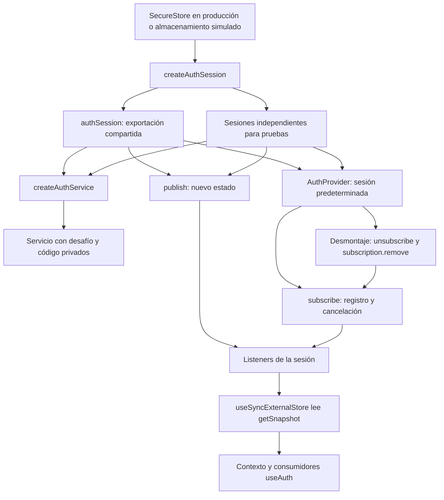

# Evidencia de patrones de sesión — Actividad 4

Responsable: **Víctor Gustavo Valdivia Hernández**.

Esta tarea comprueba implementaciones existentes; no cambia lógica productiva,
contratos, Google Sign-In ni dependencias. Parte de `develop`, commit
`68a7765bff7c35739d92a426a7631c5fe78555c0`, en la rama independiente
`test/patrones-arquitectura`. El trabajo de ProductRepository del PR #152 permanece
separado y no forma parte de esta evidencia.

## Diagnóstico y cobertura anterior

- `auth-session.test.ts`: persistencia opcional de refresh, rotación, errores,
  concurrencia y protección ante respuestas tardías, además del comportamiento
  existente de Google. Las sesiones se construyen con almacenamiento simulado.
- `auth-service.test.ts`: registro, recuperación, códigos, cancelación y vencimiento.
- `AuthProvider.test.tsx`: revalidación al volver a primer plano y limpieza de caché
  al salir. Desmonta el provider, pero no afirmaba explícitamente la cancelación
  de todas sus suscripciones.

La ejecución previa de esas tres suites aprueba **29 pruebas**. Faltaba evidencia
directa de identidad modular, aislamiento entre factories, múltiples observadores
y ausencia de notificaciones después de cancelar o desmontar.

## Tabla de patrones

Los fragmentos corresponden al código productivo existente. Las pruebas nuevas
viven en [auth-patterns.test.tsx](../src/features/auth/__tests__/auth-patterns.test.tsx).

| Patrón                      | Archivo                                      | Función o elemento                                              | Responsabilidad                                                                                                                          | Fragmento real                                                                      | Prueba que demuestra el comportamiento                                                                                                                                                | Limitación técnica                                                                                                                                                      |
| --------------------------- | -------------------------------------------- | --------------------------------------------------------------- | ---------------------------------------------------------------------------------------------------------------------------------------- | ----------------------------------------------------------------------------------- | ------------------------------------------------------------------------------------------------------------------------------------------------------------------------------------- | ----------------------------------------------------------------------------------------------------------------------------------------------------------------------- |
| Singleton modular           | `src/features/auth/services/auth-session.ts` | `authSession`                                                   | Compartir la sesión predeterminada entre consumidores del mismo módulo.                                                                  | `export const authSession = createAuthSession(`                                     | «comparte la misma exportación entre consumidores y conserva su identidad al crear sesiones aisladas»                                                                                 | Una instancia por módulo evaluado/runtime. No garantiza unicidad entre procesos, runtimes o reevaluaciones; no es un Singleton clásico GoF con constructor restringido. |
| Uso productivo de Singleton | `src/providers/auth-provider.tsx`            | `AuthProvider`                                                  | Utilizar la sesión compartida cuando no se inyecta otra.                                                                                 | `session = authSession,`                                                            | «usa la sesión compartida por defecto en AuthProvider sin crear otra sesión de producción»                                                                                            | El provider admite sesiones inyectadas. Persistencia de la identidad en memoria no equivale a persistencia de tokens entre reinicios.                                   |
| Factory                     | `src/features/auth/services/auth-session.ts` | `createAuthSession(storage, isCompromisedDevice)`               | Construir una sesión con estado, tokens, versiones y listeners privados; aceptar almacenamiento y comprobación de dispositivo simulados. | `let accessToken: string \| null = null;`                                           | «aísla estado, tokens, versiones, almacenamiento y listeners entre sesiones con dependencias simuladas»                                                                               | El aislamiento del cierre no convierte en independientes las dependencias que el llamador decida compartir. HTTP sigue siendo infraestructura compartida.               |
| Factory                     | `src/features/auth/services/auth-service.ts` | `createAuthService(session)`                                    | Construir acciones y desafíos privados usando la sesión suministrada.                                                                    | `login: session.login,`                                                             | «delega login en la sesión inyectada sin utilizar la sesión compartida ni HTTP»; «mantiene desafíos, códigos verificados y cancelaciones independientes entre servicios»              | Factory funcional; no Factory Method por herencia ni Abstract Factory. Las peticiones de desafíos siguen usando `authPost`.                                             |
| Observer                    | `src/features/auth/services/auth-session.ts` | `subscribe`, `publish`, `getSnapshot`                           | Registrar listeners, publicar estado y permitir cancelar cada suscripción.                                                               | `listeners.forEach((listener) => listener());`                                      | «notifica a varios suscriptores con el snapshot publicado y deja de notificar tras cancelar»; «mantiene el snapshot estable entre lecturas y publica uno nuevo sin mutar el anterior» | Notificaciones síncronas en memoria. El snapshot se comparte por referencia y los consumidores no deben mutarlo; no está congelado.                                     |
| Integración Observer/React  | `src/providers/auth-provider.tsx`            | `useAuthState`, `useSyncExternalStore` y cleanup de `useEffect` | Actualizar el contexto React y retirar suscripciones de sesión y AppState al desmontar.                                                  | `useSyncExternalStore(session.subscribe, session.getSnapshot, session.getSnapshot)` | «actualiza consumidores React y limpia todas las suscripciones del provider al desmontar»                                                                                             | Jest simula React Native y AppState; no certifica comportamiento nativo, SecureStore real ni Google Sign-In.                                                            |

## Relación entre factories, instancia compartida y React



Cada sesión creada por la factory tiene su propio `Set` de listeners y su propia
función `publish`. El diagrama representa esa relación; no introduce un bus de eventos.

## Pruebas añadidas y alcance

La suite nueva añade ocho casos. Carga la sesión con `jest.requireActual` por dos rutas
equivalentes dentro del mismo registro de módulos; no reinicia módulos para fabricar una segunda
instancia de producción. Las operaciones que cambian estado usan sesiones aisladas;
la prueba del provider predeterminado simula únicamente `restore` para evitar
acceso a almacenamiento nativo o red.

La prueba de aislamiento compara tokens, identidad, versiones, almacenamiento y
listeners de dos sesiones. La de servicios comparte deliberadamente una dependencia
de sesión para demostrar que los desafíos, códigos y cancelaciones pertenecen a
cierres independientes. Ninguna de estas pruebas llama al backend real.

La prueba React observa las suscripciones reales creadas por el provider, verifica
que dos lecturas de contexto reciben el usuario publicado y que todas las funciones
de cancelación se ejecutan al desmontar. Después publica otro estado y comprueba
que no hay callbacks residuales ni limpieza de caché por un provider ya desmontado.

Comando relacionado:

```bash
npm test -- --runInBand --selectProjects unit --runTestsByPath src/features/auth/__tests__/auth-patterns.test.tsx src/features/auth/__tests__/auth-session.test.ts src/features/auth/__tests__/auth-service.test.ts src/features/auth/__tests__/AuthProvider.test.tsx
```

Validación completa:

```bash
npm run typecheck
npm run lint
npm run format:check
npm test -- --runInBand
git diff --check
```

## Resultados del 27 de octubre de 2026

| Verificación                                  | Resultado                                                               |
| --------------------------------------------- | ----------------------------------------------------------------------- |
| Baseline relacionado, antes de añadir pruebas | 3 suites y 29 pruebas aprobadas.                                        |
| Suites relacionadas con la prueba nueva       | 4 suites y 37 pruebas aprobadas, sin advertencias en esa ejecución.     |
| Regresión completa en esta rama independiente | 71 suites y 383 pruebas aprobadas; 0 fallidas y 0 snapshots.            |
| `npm run typecheck`                           | Aprobado.                                                               |
| `npm run lint`                                | Aprobado, sin errores ni advertencias tras corregir imports duplicados. |
| `npm run format:check`                        | Aprobado.                                                               |
| `git diff --check`                            | Aprobado.                                                               |

El primer intento de la prueba de identidad usó `import()` dinámico y falló por la
configuración de Jest, que requería `--experimental-vm-modules`. Se sustituyó por
carga del módulo real en caché, sin cambiar configuración ni lógica productiva.
Un intento intermedio con imports estáticos repetidos produjo dos advertencias de
ESLint; también quedaron resueltas con `jest.requireActual`. La reejecución de las
cuatro suites relacionadas aprobó los 37 casos con el código final.

La regresión completa emitió avisos de React por actualizaciones fuera de `act(...)`
en las suites existentes de catálogo y favoritos. No se silenciaron ni se cambiaron
esas pruebas. Los totales no incluyen las pruebas de ProductRepository del PR #152,
porque esta rama parte de `develop` sin incorporar ese PR.

## Límites arquitectónicos y revisión pendiente

Singleton modular, factories y Observer describen responsabilidades concretas del
código existente. No convierten automáticamente la aplicación en Clean Architecture.
La arquitectura sigue organizada por features y capas, con aproximación a MVVM
mediante hooks y separación parcial de presentación y acceso a datos.

La evidencia automatizada no reemplaza validación nativa de almacenamiento,
foreground/background o Google Sign-In. Esta tarea no modifica esas funcionalidades
ni requiere ejecutar pruebas destructivas o cambiar el backend. Esta evidencia se
revisa y publica mediante un PR a `develop`; publicarla no implica fusionarla.
