# Flujo Git y gestión del trabajo

## Estrategia vigente

```text
feature/* → develop → main
```

La rama `develop` existe y es la rama de integración utilizada por el proyecto.

## Flujo de una tarea

```mermaid
flowchart LR
  Issue[Issue / Task] --> Branch[feature/* desde develop]
  Branch --> Commits[Commits pequeños]
  Commits --> PR[Pull Request a develop]
  PR --> Review[Review]
  Review --> Tests[Pruebas y QA]
  Tests --> Develop[Merge a develop]
  Develop --> Release[Validación de release]
  Release --> Main[Merge a main]
  Main --> Tag[Tag SemVer]
```



## Ramas

- `main`: versiones estables y validadas.
- `develop`: integración de funcionalidades terminadas.
- `feature/<descripcion-corta>`: desarrollo aislado de una tarea o cambio coherente, creado desde `develop`.

Las ramas `feature/*` se integran de regreso a `develop` mediante Pull Request. `main` no se usa para desarrollo ordinario. No mezcles refactors no relacionados en una rama de feature.

## Commits

- pequeños, coherentes y revisables;
- mensaje imperativo que explique el cambio;
- seguir Conventional Commits (`ci:`, `test:`, `docs:`, `fix:`, `feat:` según el cambio);
- no incluir secretos, artefactos locales ni archivos generados innecesarios;
- separar cambios funcionales, pruebas y documentación solo cuando ayude a la revisión, sin fragmentar artificialmente.

## Pull Request

Un PR hacia `develop` debe incluir:

- problema y resultado observable;
- alcance y exclusiones;
- screenshots o video para UI relevante;
- contratos backend verificados;
- pruebas agregadas y comandos ejecutados;
- riesgos, migraciones y decisiones pendientes;
- cambios de dependencias justificados, si los hay.

Quality y Tests se ejecutan en PR hacia `develop`/`main` y en push a esas ramas. El merge a `develop` genera un push y vuelve a validar el estado integrado; no requiere un workflow adicional de merge. Los pushes de ramas de trabajo con PR se validan por el evento del PR, evitando otro run idéntico en cada push de feature.

Configurar manualmente protección/rulesets en `develop` y `main` para exigir PR, revisión y los checks `validate` (Quality), `unit` e `integration` (Tests), verificando sus nombres en el primer run. Detalles de orden, reportes y límites en [TESTING.md](./TESTING.md). Un fallo no se ignora y debe bloquear el merge cuando esos checks sean obligatorios.

Los agentes dejan cambios sin confirmar para revisión humana: no ejecutan `git add`, commit, push, merge, cambios/creación de ramas ni creación de PR salvo autorización explícita para esa operación. Los reportes generados permanecen ignorados; no se versionan automáticamente.

## Release

Después de validar `develop`:

1. ejecutar validación completa;
2. confirmar versión y notas;
3. fusionar a `main` según la política del equipo;
4. crear tag SemVer;
5. conservar trazabilidad hacia issues y PRs.

SemVer:

- `MAJOR`: cambio incompatible;
- `MINOR`: funcionalidad compatible;
- `PATCH`: corrección compatible.

La versión de app y estrategia EAS todavía requieren definición.

## Scrum + Kanban

Estados acordados:

```text
Backlog → Todo → In Progress → Review / Testing → Done
```

- **Backlog:** idea o necesidad priorizable.
- **Todo:** alcance y criterios suficientemente claros.
- **In Progress:** trabajo activo en una rama.
- **Review / Testing:** implementación terminada, revisión y QA pendientes.
- **Done:** cumple definición de Done y está aceptada.

## Definition of Done

Una tarea no está Done solo porque compile. Debe cumplir, según alcance:

- criterios de aceptación;
- contrato backend confirmado;
- lint, typecheck, format y tests aplicables;
- estados loading, empty, error y offline;
- accesibilidad y responsive;
- Android/iOS verificados cuando afecte UI o APIs nativas;
- revisión de seguridad y secretos;
- documentación actualizada si cambió arquitectura o contrato;
- PR revisado y sin errores nuevos conocidos.

Los fallos preexistentes deben documentarse; los nuevos deben resolverse.
