# Flujo Git y gestión del trabajo

## Estrategia objetivo

```text
main
develop
feature/*
```

Estado auditado: el repositorio móvil está en `main` y no se observó una rama local `develop`. La adopción inicial de `develop` requiere una decisión y acción explícita; esta documentación no crea ramas.

## Flujo de una tarea

```mermaid
flowchart LR
  Issue[Issue / Task] --> Branch[feature/* desde develop]
  Branch --> Commits[Commits pequeños]
  Commits --> PR[Pull Request a develop]
  PR --> Review[Review]
  Review --> Tests[Pruebas y QA]
  Tests --> Develop[Merge a develop]
  Develop --> Release[Validación de release]
  Release --> Main[Merge a main]
  Main --> Tag[Tag SemVer]
```



## Ramas

- `main`: releases validadas.
- `develop`: integración de trabajo aprobado.
- `feature/<descripcion-corta>`: una tarea o cambio coherente, creada desde `develop`.

No desarrolles features ordinarias directamente en `main`. No mezcles refactors no relacionados en una rama de feature.

## Commits

- pequeños, coherentes y revisables;
- mensaje imperativo que explique el cambio;
- no incluir secretos, artefactos locales ni archivos generados innecesarios;
- separar cambios funcionales, pruebas y documentación solo cuando ayude a la revisión, sin fragmentar artificialmente.

## Pull Request

Un PR hacia `develop` debe incluir:

- problema y resultado observable;
- alcance y exclusiones;
- screenshots o video para UI relevante;
- contratos backend verificados;
- pruebas agregadas y comandos ejecutados;
- riesgos, migraciones y decisiones pendientes;
- cambios de dependencias justificados, si los hay.

## Release

Después de validar `develop`:

1. ejecutar validación completa;
2. confirmar versión y notas;
3. fusionar a `main` según la política del equipo;
4. crear tag SemVer;
5. conservar trazabilidad hacia issues y PRs.

SemVer:

- `MAJOR`: cambio incompatible;
- `MINOR`: funcionalidad compatible;
- `PATCH`: corrección compatible.

La versión de app y estrategia EAS todavía requieren definición.

## Scrum + Kanban

Estados acordados:

```text
Backlog → Todo → In Progress → Review / Testing → Done
```

- **Backlog:** idea o necesidad priorizable.
- **Todo:** alcance y criterios suficientemente claros.
- **In Progress:** trabajo activo en una rama.
- **Review / Testing:** implementación terminada, revisión y QA pendientes.
- **Done:** cumple definición de Done y está aceptada.

## Definition of Done

Una tarea no está Done solo porque compile. Debe cumplir, según alcance:

- criterios de aceptación;
- contrato backend confirmado;
- lint, typecheck, format y tests aplicables;
- estados loading, empty, error y offline;
- accesibilidad y responsive;
- Android/iOS verificados cuando afecte UI o APIs nativas;
- revisión de seguridad y secretos;
- documentación actualizada si cambió arquitectura o contrato;
- PR revisado y sin errores nuevos conocidos.

Los fallos preexistentes deben documentarse; los nuevos deben resolverse.
